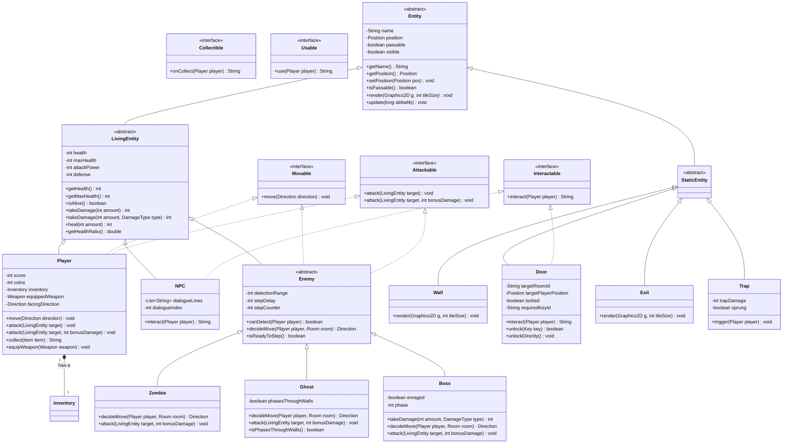
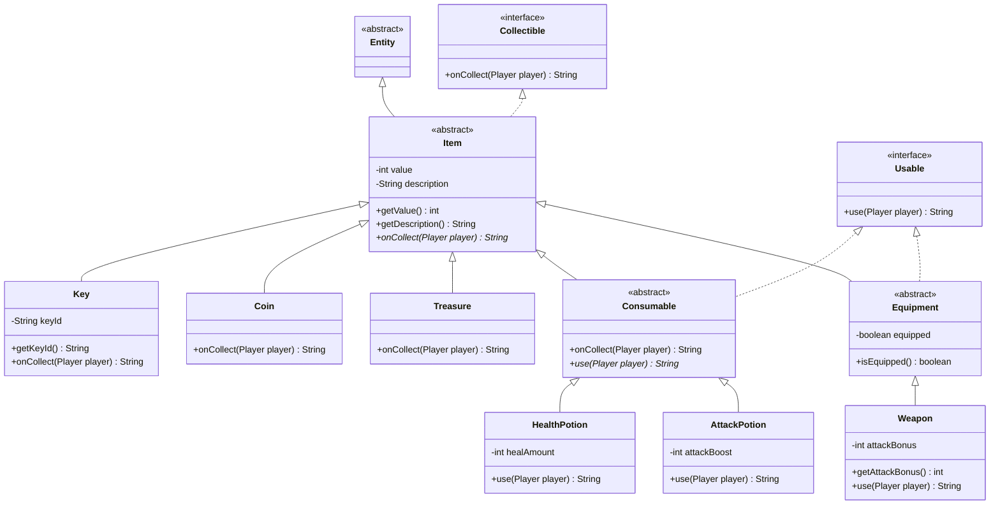
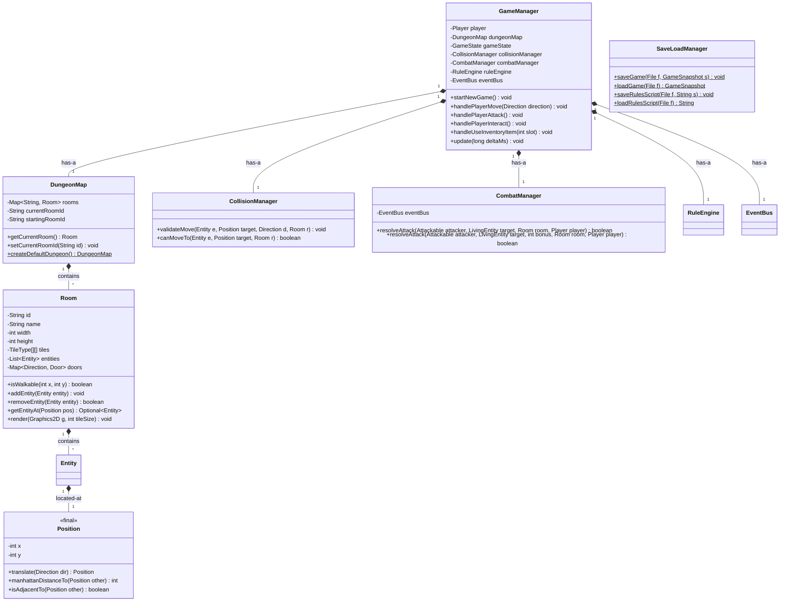
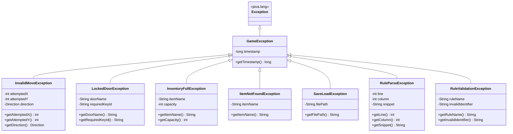

# Dungeon Escape — Complete UML Class Diagrams

This document provides the complete UML Class Diagrams for the **Dungeon Escape** project, formatted using standard Mermaid syntax. The diagrams reflect the **exact codebase implementation** without approximations.

---

## 1. Core Entity & Behavioral Interface Hierarchy

---

## 2. Item & Equipment Hierarchy

---

## 3. Player-Defined Rule Engine (DSL & AST)

```mermaid
classDiagram
    class RuleEngine {
        -List~Rule~ rules
        -int evaluationCycles
        +registerRuleFromSource(String sourceText) Rule
        +evaluateAll(RuleContext context) int
        +attachToEventBus(EventBus bus, RuleContext context) void
    }

    class Rule {
        -String name
        -Expression~Boolean~ condition
        -Action action
        -String sourceText
        -boolean enabled
        -int executionCount
        +evaluateAndExecute(RuleContext context) boolean
    }

    class RuleContext {
        -GameManager gameManager
        +getVariable(String identifier) Object
        +setVariable(String identifier, Object value) boolean
        +callFunction(String name, List args) Object
        +spawnEntity(String type, int x, int y) boolean
        +unlockDoor(String doorName) boolean
    }

    class Expression~T~ {
        <<interface>>
        +evaluate(RuleContext context) T
    }

    class LiteralExpression~T~ {
        -T value
        +evaluate(RuleContext context) T
    }

    class VariableExpression {
        -String identifier
        +evaluate(RuleContext context) Object
    }

    class BinaryArithmeticExpression {
        -Expression left
        -Operator operator
        -Expression right
        +evaluate(RuleContext context) Double
    }

    class ComparisonExpression {
        -Expression left
        -Operator operator
        -Expression right
        +evaluate(RuleContext context) Boolean
    }

    class LogicalExpression {
        -Expression~Boolean~ left
        -Operator operator
        -Expression~Boolean~ right
        +evaluate(RuleContext context) Boolean
    }

    class FunctionCallExpression {
        -String functionName
        -List~Expression~ arguments
        +evaluate(RuleContext context) Object
    }

    class Action {
        <<interface>>
        +execute(RuleContext context) void
    }

    class AssignmentAction {
        -String targetIdentifier
        -AssignType assignType
        -Expression expression
        +execute(RuleContext context) void
    }

    class SpawnAction {
        -String entityType
        -Expression xExpr
        -Expression yExpr
        +execute(RuleContext context) void
    }

    class UnlockAction {
        -String doorName
        +execute(RuleContext context) void
    }

    class MessageAction {
        -String messageText
        +execute(RuleContext context) void
    }

    class CompositeAction {
        -List~Action~ actions
        +execute(RuleContext context) void
    }

    RuleEngine "1" *-- "*" Rule : manages
    Rule "1" *-- "1" Expression : condition
    Rule "1" *-- "1" Action : action

    Expression <|.. LiteralExpression
    Expression <|.. VariableExpression
    Expression <|.. BinaryArithmeticExpression
    Expression <|.. ComparisonExpression
    Expression <|.. LogicalExpression
    Expression <|.. FunctionCallExpression

    Action <|.. AssignmentAction
    Action <|.. SpawnAction
    Action <|.. UnlockAction
    Action <|.. MessageAction
    Action <|.. CompositeAction
    CompositeAction "1" *-- "*" Action : composite
```

---

## 4. World Graph, Map & Management

---

## 5. Custom Checked Exception Hierarchy

